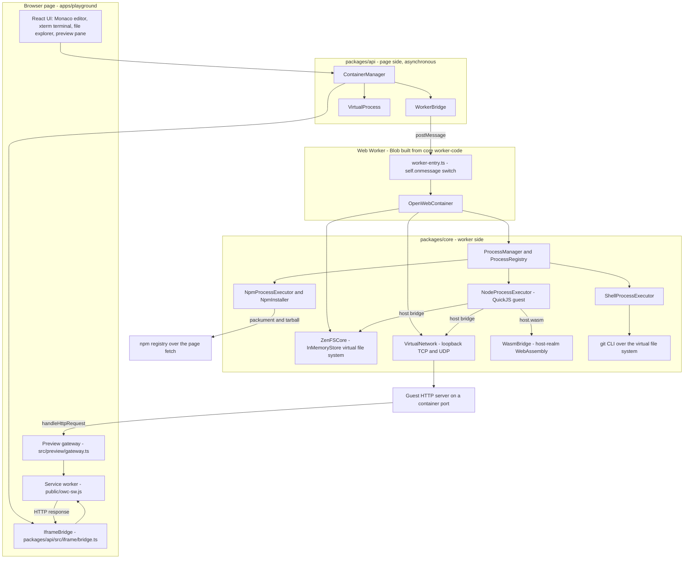
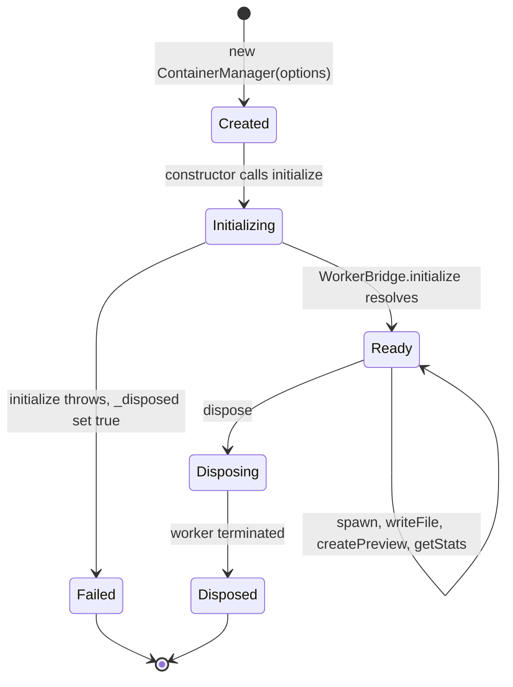

# OpenWebContainer

## Global npm installs

`npm install -g` installs into the VFS prefix, links bins into `<PREFIX>/bin` on `PATH`, and writes nothing into the cwd. Global modules are **NOT** on `require()` resolution from an unrelated cwd. `npm ls -g`, `npm uninstall -g`, `npm root -g`, `npm prefix -g` and `npm config get globalconfig` are supported; see [npm global installs](docs/reference/npm-global.md). The archived compatibility-notes.md "Global installs are refused" statements (line 118) are **SUPERSEDED**; that archive is left verbatim.


[](LICENSE)
[](CONTRIBUTING.md)

## What this actually is

OpenWebContainer is a browser-hosted, Node-compatible container. It runs your JavaScript inside **QuickJS in a Web Worker**, with a virtual file system, processes, an interactive shell, `npm`, a virtual loopback network, and a service-worker preview gateway that turns an HTTP server inside the container into a page you can browse. It is **not** a Docker container, **not** a Node process running on your host, and **not** a complete clone of Node: it is a compatibility layer whose behaviour is measured, case by case, against host Node v24.15.0. Everything lives in the browser page — there is no server to provision, no binary to install on a machine, and no process on your host to clean up.


The playground page, the API bridge, the Web Worker and the container runtime ([architecture](docs/architecture.md)). The raster above is the original overview; the Mermaid diagrams below are the maintained, source-linked version. See [Architecture diagrams](docs/architecture.md#diagrams) for the full set and [State machines](docs/reference/state-machines.md) for the lifecycle, budget, routing, retry and dispatch machines.

## System architecture at a glance



**Text alternative.** The React UI creates one `ContainerManager` for the page. `ContainerManager` owns a `WorkerBridge`, produces `VirtualProcess` objects and uses `IframeBridge` for previews. `WorkerBridge` turns core's `worker-code` export into a Blob Worker and sends it `postMessage` requests; the worker's `self.onmessage` switch in `worker-entry.ts` constructs `OpenWebContainer`. That class owns the ZenFS virtual file system, the process manager and the virtual network. The process manager dispatches to the `node`, `sh` and `npm` executors. The `node` executor reaches the file system and the network through the host bridge, and reaches host-realm `WebAssembly` through `host.wasm`; the shell dispatches `git` as a module command over the same file system; the npm executor fetches packuments and tarballs through the page's `fetch`. A guest HTTP server receives requests through `handleHttpRequest`, and the service worker answers the browser after the preview gateway has forwarded the request. No arrow leaves the browser except the npm registry fetch. Sources: `packages/api/src/container/container.ts:8-33`, `packages/api/src/worker/bridge.ts:130-140`, `packages/core/src/worker-entry.ts:10-35`, `packages/core/src/container.ts:55`, `apps/playground/public/owc-sw.js:83-90`, `apps/playground/src/preview/gateway.ts:113-155`.

### Container lifecycle



**Text alternative.** Construction immediately starts `initialize()`. A successful `WorkerBridge.initialize()` sets `_isReady`; a throw sets `_disposed` and rethrows, so `waitForReady()` rejects. While ready, spawn, file, preview and stats calls are repeatable without leaving the state. `dispose()` moves the container to a terminal state after the worker is terminated. Sources: `packages/api/src/container/container.ts:13-15,35-60`, `packages/api/src/worker/bridge.ts:101-119`; full machine and tables in [State machines](docs/reference/state-machines.md#1-container-lifecycle).

The [Architecture page](docs/architecture.md#diagrams) adds the boot sequence, package graph, capability bridge, VFS and npm install, virtual network, multi-tab preview gateway, WASM bridge and git dispatch diagrams. Every diagram there, and every machine in [State machines](docs/reference/state-machines.md), has a plain-text alternative; no block uses colour as the only carrier of meaning.

### What it is not

| It is not | Because |
| --- | --- |
| A Docker container | No Linux kernel, no OS image, no host process. The "container" is a QuickJS context plus a virtual file system inside a Web Worker. |
| A host Node process | Nothing is installed on your machine and nothing runs in Node. The `node` command is a guest executor implemented over QuickJS. |
| A complete Node clone | Compatibility is measured case by case against host Node v24.15.0. Real packages, built-ins, streams, `crypto`, `worker_threads`, HTTP servers and WASM do run, but some namespaces are narrower and six WPT URL deviations plus 20 IDNA cases remain. |
| A way to reach a database over TCP | The network is virtual loopback. Use HTTP/API-accessible services instead. |
| An isolated-by-default host page | Cross-origin isolation headers (COOP/COEP) are the host page's responsibility, not the runtime's. |

### How compatibility is decided

Every case runs the same script on host Node v24.15.0 and in one fresh container process, and compares **stdout, stderr and exit code**. A fix is recorded only when all three agree, usually at two memory points. The repository has no `.github/workflows`, so those measurements are not CI-verified; see [Compatibility](docs/compatibility.md) and the [verbatim notes archive](docs/reference/compatibility-notes.md).

## Git in the container

git runs as a shell module command over the VFS: local init, add, commit, log, status, branch, checkout, diff and a local-path clone work against the self-contained object store in packages/core/src/git/. URL-based remote transports (clone, fetch, pull, push, ls-remote, remote show/prune/update, submodule, credential), GPG signing, hooks, packfiles, worktrees and gitlinks are named boundaries that report the project [CODE] not supported on this runtime outcome with exit 1; `git remote add/get-url/remove/rename/set-url/-v` and local-path fetch/push/pull/ls-remote are LOCAL VFS operations, and `bisect`/`fsck` are implemented over the VFS. All 18 declared git-* boundary keys are reachable. An unrecognised subcommand returns a generic not-a-git-command line, never a bare 127. See the [git command reference](docs/reference/commands-git.md). The verbatim compatibility archive's git-absent lines are no longer current: archive :505/:508/:511 are SUPERSEDED, and that archive is left byte-for-byte unchanged.

## Try it

Prerequisites: Git, Node.js, and pnpm. The repository pins `pnpm@8.15.3` in the root `package.json` (`packageManager`) and declares no `engines` minimum; the compatibility measurements were taken on Node v24.15.0. You also need a browser with Web Worker and service worker support.

```bash
git clone https://github.com/dywongcloud/OpenWebContainer.git
cd OpenWebContainer
pnpm install
pnpm dev          # all packages, or:
pnpm playground   # just the playground
```

Open <http://localhost:5173>. Vite serves the playground there by default. The playground creates one container for the page, shows a file explorer, a Monaco editor and a terminal, and starts no other service.

To write your first file and run it, see [Getting started](docs/getting-started.md). For the exact TypeScript surface, see the [API reference](docs/api.md).

## What you can run

- `node` — CommonJS and ES modules, `node_modules` resolution, `node -e`, `node --test`.
- `sh` — an interactive shell with built-in commands, pipes and redirection.
- `npm` and `npx` — `npm install`, `npm run`, `npm exec`, and installs from a directory in the virtual file system.
- WebAssembly modules, including real npm packages that ship WASM.
- Real packages installed from the npm registry (`lodash`, `prettier`, `xlsx`, `cheerio`, `hash-wasm`, and others) with their dependency trees.
- Node built-ins: `path`, `events`, `util`, `assert`, `fs`, `crypto`, streams, `http`, `https`, `http2`, `net`, `dgram`, `dns`, `child_process`, `worker_threads` and `cluster`, plus Web Streams and the usual web globals.
- HTTP servers listening on container ports, reached through the preview gateway at `/__owc/preview/<port>/...`.

## What you need to be aware of

This is the most important section. The container is deliberately *not* a general-purpose server:

- **No outbound raw TCP or UDP.** The virtual network is loopback-only, between processes of one container. Direct-TCP database drivers (MongoDB, Mongoose, PostgreSQL, MySQL) cannot connect from a browser-hosted container; use an HTTP/API-accessible provider instead.
- **Guest `fetch` is the container's own undici**, served over its own `http`/`https` client. It is not browser `fetch` and not host undici, so do not assume CORS, preflight, connection, stream or redirect behaviour matches either.
- **Cross-origin isolation is the host page's job.** A host must serve `Cross-Origin-Opener-Policy: same-origin` together with `Cross-Origin-Embedder-Policy: require-corp` (or `credentialless`). A recorded Chrome measurement at `:5173` found `crossOriginIsolated=false` and `typeof SharedArrayBuffer=undefined`; `apps/playground/vite.config.ts` now declares both headers, but check the actual response headers of your deployment before relying on shared memory.
- **One host thread, pinned to QuickJS.** There is no second thread to preempt a busy worker. A runaway guest is stopped from inside by a QuickJS interrupt handler after a 30000 ms default budget (`guestBudgetMs`), not by a host timer. Some language behaviour and the small `Intl` placeholder subset come from the pinned engine.
- **Some Node surfaces are partial.** `fs.glob`/`globSync` are absent; `node:util` exposes 22 of the host's 35 names; several built-in namespaces are narrower than host Node's.
- **Measurement is differential, not CI-verified.** Compatibility is established by comparing stdout, stderr and exit code against host Node v24.15.0, and the repository has no `.github/workflows`. Six host-Node deviations from the WPT URL fixture and 20 documented IDNA cases remain.

Read [Known limitations](docs/known-limitations.md) before you plan an application around this runtime. The full measured record is preserved verbatim in the [compatibility notes archive](docs/reference/compatibility-notes.md).

## Documentation

| Page | What it covers |
| --- | --- |
| [docs/README.md](docs/README.md) | Index of every page |
| [Getting started](docs/getting-started.md) | Prerequisites, install, first container, first command, preview ports |
| [Architecture](docs/architecture.md) | Worker, QuickJS, host bridge, ZenFS, executors, virtual network, preview gateway, UI |
| [API reference](docs/api.md) | The real `OpenWebContainer` and `ContainerManager` methods and events |
| [Compatibility](docs/compatibility.md) | The target, spec baselines and measured conformance numbers |
| [Known limitations](docs/known-limitations.md) | User-facing boundaries, each with its measured basis |
| [Development](docs/development.md) | Real scripts, build order and turbo tasks |
| [Troubleshooting](docs/troubleshooting.md) | Problems actually seen in this repository |
| [Architecture diagrams](docs/architecture.md#diagrams) | Nine maintained Mermaid system diagrams with pinned source paths. |
| [State machines](docs/reference/state-machines.md) | Ten state machines with prose alternatives and transition tables. |
| [Compatibility notes archive](docs/reference/compatibility-notes.md) | The former chronological `Readme.md`, byte-for-byte below a one-line header |

## Project layout

```
.
├── apps/playground/          React + Vite playground (terminal, editor, file explorer, preview)
│   ├── public/owc-sw.js      service worker for the preview gateway
│   └── src/preview/          page side of the gateway
├── packages/core/            the container runtime: QuickJS, ZenFS virtual file system,
│                            process executors (node, sh, npm), virtual network hub
├── packages/api/             browser-facing layer: ContainerManager, WorkerBridge,
│                            VirtualProcess events, IframeBridge previews
├── docs/                     this documentation
├── images/architecture.png   architecture diagram
├── scripts/                  repository scripts (including the staged-secrets check)
├── closes/                   one record per closed compatibility row
├── pnpm-workspace.yaml       workspace globs
└── turbo.json                turbo task graph
```

The repository is a pnpm workspace with three packages and no `.github/workflows` directory:

- `packages/core` is published as `@open-web-container/core` and exposes `.` and `./worker-code`.
- `packages/api` is published as `@open-web-container/api` and depends on core via `workspace:*`.
- `apps/playground` is private, uses Vite 5 and React 18, and is the only application in the workspace.
- `closes/` holds one record per closed compatibility row; `scripts/` holds repository tooling.

The playground imports `@open-web-container/api`; that package depends on `@open-web-container/core`, which also publishes the worker code the page boots as a Blob Worker.

## Development

`pnpm dev` runs `turbo run dev --parallel`; `pnpm playground` filters to the playground; `pnpm build` runs `turbo run build`. The core package builds its guest bundles before the worker bundle, in the order `build:napi-guest`, `build:quic-guest`, `build:worker`, `build:main`. The root `pnpm test` script is a placeholder that exits 1 — there is no root test runner. See [Development](docs/development.md) for the full script table, and [CONTRIBUTING.md](CONTRIBUTING.md) for the contribution workflow.

## Contributing

Contributions are welcome. Start with [CONTRIBUTING.md](CONTRIBUTING.md) and the [documentation index](docs/README.md).

## License

MIT — see [LICENSE](LICENSE). Note that `packages/core/package.json` declares `ISC` for that package, while the root manifest and `LICENSE` say MIT.

## Support

Start with the [documentation index](docs/README.md) and [Troubleshooting](docs/troubleshooting.md). For a measured behaviour, the [compatibility notes archive](docs/reference/compatibility-notes.md) holds the original chronological record in full. The GitHub repository currently reports Issues disabled (`has_issues=false`), so there is no issue tracker to file against; use [CONTRIBUTING.md](CONTRIBUTING.md) for how to propose a change.

Built on [QuickJS](https://bellard.org/quickjs/) and [quickjs-emscripten](https://github.com/justjake/quickjs-emscripten).
