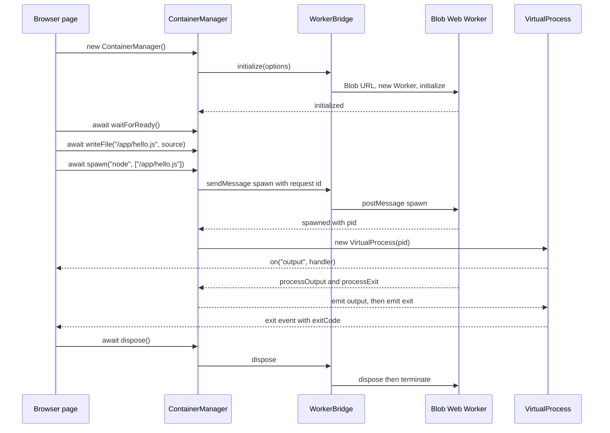
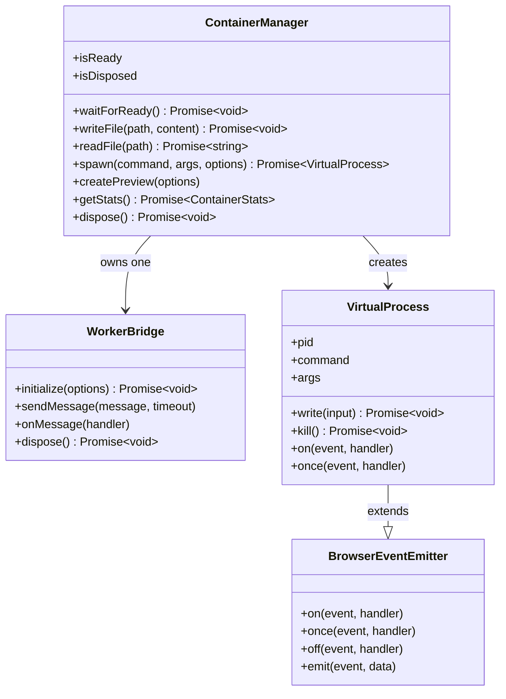
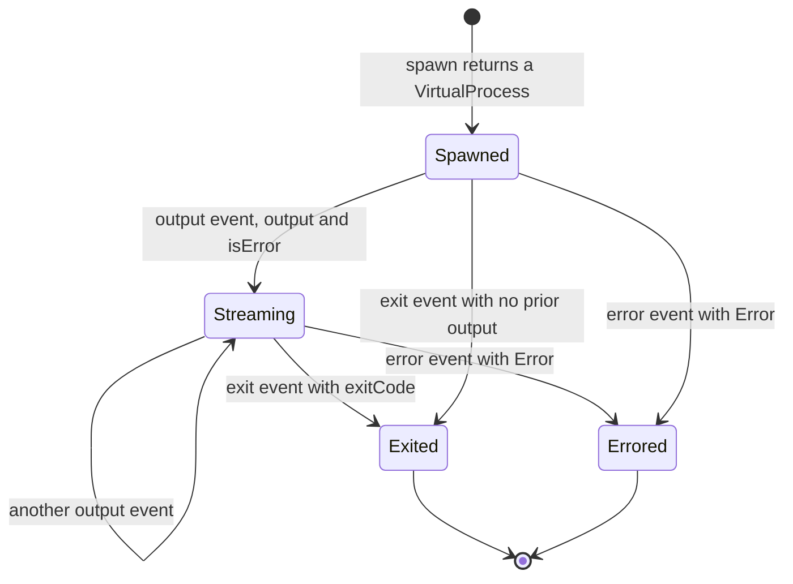

# API reference

Two packages, two surfaces. Both are real on `origin/main`. Every signature below was read from the source, not from the old Readme.

- `@open-web-container/core` exports `OpenWebContainer` (worker-side, **synchronous** filesystem calls) plus `Process`, `ProcessRegistry`, `ProcessManager`, `ProcessEvent`, `ProcessState`, `ShellProcess` and the type `ProcessExecutor`.
- `@open-web-container/api` exports `ContainerManager` (page-side, **asynchronous**, talks to the worker), `VirtualProcess`, `BrowserEventEmitter`, `ContainerOptions`, `ProcessOptions` and `WorkerBridge` (`src/index.ts` re-exports `./container`, `./process` and `./worker`). It does **not** re-export `OpenWebContainer`, and `IframeBridge` / `HostRequest` in `src/iframe/bridge.ts` are internal types imported by `ContainerManager`, not public exports.

## Lifecycle diagrams

Three surfaces, one page-side lifecycle. The diagrams are fenced Mermaid; GitHub renders them in light and dark colour modes. No block uses a categorical palette, so no class or state is encoded by colour alone. Every block is followed by a **Text alternative**. All labels are ASCII. See [Architecture diagrams](architecture.md#diagrams) for the runtime path and [State machines](reference/state-machines.md) for the complete lifecycle tables.



**Text alternative.** The page constructs `ContainerManager` and waits for `waitForReady()`. It writes a file, then calls `spawn` with an **array** of arguments. The manager sends a numbered `spawn` request through `WorkerBridge`; the worker replies with the pid and the manager creates a `VirtualProcess`. Output and exit arrive as worker messages and are emitted on that `VirtualProcess`, which exposes `on`, `once`, `off` and `emit` but not `addEventListener`. `dispose()` tears down the worker. Sources: `packages/api/src/container/container.ts:19-60,62-95`, `packages/api/src/worker/bridge.ts:61-92,101-119`, `packages/core/src/worker-entry.ts:28-52`, `docs/api.md` ContainerManager and VirtualProcess sections.



**Text alternative.** `ContainerManager` owns one `WorkerBridge` and creates `VirtualProcess` instances. `VirtualProcess` extends `BrowserEventEmitter`, which is why it has `on`, `once`, `off` and `emit` and why its event map has exactly `output`, `exit` and `error`. The **core** `Process` class is a different surface: it adds typed `addEventListener` overloads for `start`, `exit`, `error`, `message` and `spawn_child`, and file calls there are synchronous. The manager has no `deleteDirectory`, `readFileBytes` or `listFilesPaced`; core has all three. Sources: `docs/api.md` method and event tables, `packages/api/src/process/process.ts`, `packages/core/src/process/base/process.ts:292-300`, `packages/api/src/container/types.ts`, `packages/api/src/process/types.ts`.



**Text alternative.** `VirtualProcess` has only three events. `output` carries `{ output, isError }` and may repeat; `exit` carries `{ exitCode: number | null }`; `error` carries `{ error: Error }`. There is no `start` or `message` event on this class. `isRunning`, `exitCode`, `startTime`, `endTime` and `uptime` are getters over the same process record. Sources: `docs/api.md` ProcessEventMap table, `packages/api/src/process/types.ts`, `packages/api/src/process/process.ts`.

## `OpenWebContainer` (`packages/core/src/container.ts`)

```ts
import { OpenWebContainer } from '@open-web-container/core';

const core = new OpenWebContainer(); // constructor(options: ContainerOptions = {})
await core.dispose();                // async dispose(): Promise<void>
```

`core.ContainerOptions` (`packages/core/src/container.ts:28-38`):

| Field | Type | Meaning |
| --- | --- | --- |
| `debug?` | `boolean` | Debug logging |
| `onServerListen?` | `(port: number) => void` | A guest server began listening |
| `onServerClose?` | `(port: number) => void` | A guest server closed |
| `guestBudgetMs?` | `number` | Uninterrupted guest-execution budget; default 30000, `0` disarms the runaway guard |

`SpawnOptions` (`:40-47`): `cwd?`, `env?`, `pid?`, `beforeStart?`.

### Files and directories (synchronous)

| Method | Signature |
| --- | --- |
| `writeFile` | `(path: string, content: string \| Uint8Array): void` |
| `readFile` | `(path: string): string \| undefined` |
| `readFileBytes` | `(path: string): Uint8Array \| undefined` |
| `deleteFile` | `(path: string): void` |
| `listFiles` | `(basePath: string = '/'): string[]` |
| `listFilesPaced` | `(basePath: string = '/'): Promise<string[]>` — slices the walk so a foreground child keeps the one thread |
| `createDirectory` | `(path: string): void` |
| `deleteDirectory` | `(path: string): void` |
| `listDirectory` | `(path: string): string[]` |

`writeFile` stores a `Uint8Array` as its bytes. The text form is lossy on binary: a `.wasm` written as text comes back longer and WebAssembly rejects it. Use `readFileBytes` to check a byte write.

### Processes

```ts
spawn(
    executablePath: string,
    args: string[] = [],
    parentPid?: number,
    options: SpawnOptions = {}
): Promise<Process>
```

`args` is an **array**. `spawn('node', ['/app/hello.js'])`, not `spawn('node', '/app/hello.js')`.

Other process methods: `getProcess(pid): Process | undefined`, `listProcesses(): Process[]`, `getProcessInfo(process): ProcessInfo`, `getChildProcesses(parentPid): Process[]`, `getProcessTree(pid): ProcessTree`, `getFullProcessTree(): ProcessTree[]`, `printProcessTree(tree, indent = ''): string`, `terminateProcessTree(pid): Promise<void>`, `registerProcessExecutor(type, executor): void`, `onOutput(callback): () => void`, `readonly networkManager: NetworkManager`.

Network helpers: `handleHttpRequest(request: HostRequest, port: number): Promise<Response>`, `registerServer(pid, port, type, options?): string`, `unregisterServer(port, type): void`, `getNetworkStats(): NetworkStats`, `listServers(): VirtualServer[]`.

### Process events (core)

`ProcessEvent` (`packages/core/src/process/base/types.ts`):

| Value | Literal |
| --- | --- |
| `START` | `'start'` |
| `EXIT` | `'exit'` |
| `ERROR` | `'error'` |
| `MESSAGE` | `'message'` |
| `SPAWN_CHILD` | `'spawn_child'` |

`Process` extends `BrowserEventEmitter` and provides typed `addEventListener` overloads for all five (`packages/core/src/process/base/process.ts:292-300`), and inherits `on`, `off` and `emit`. `MESSAGE` data is `{ stdout?: string; stderr?: string }`; `EXIT` data is `{ pid, exitCode, uptime }`.

```ts
const proc = await core.spawn('node', ['/app/hello.js']);
proc.addEventListener('message', (d) => console.log(d.stdout));
proc.addEventListener('error', (d) => console.error(d.error));
proc.addEventListener('exit', (d) => console.log(d.exitCode));
```

## `ContainerManager` (`packages/api/src/container/container.ts`)

```ts
import { ContainerManager } from '@open-web-container/api';

const container = new ContainerManager();          // constructor(options: ContainerOptions = {})
await container.waitForReady();                     // waitForReady(): Promise<void>
```

`api.ContainerOptions` (`packages/api/src/container/types.ts`): `debug?`, `maxProcesses?`, `memoryLimit?`, `coep?: 'require-corp' | 'credentialless' | 'none'`, `onServerListen?`, `onServerClose?`. Defaults (`container.ts:19-26`): `debug=false`, `maxProcesses=10`, `memoryLimit=512 * 1024 * 1024`, `coep='none'`. `WorkerBridge` fixes `coep` at first boot.

`ProcessOptions` (`packages/api/src/process/types.ts`): `cwd?`, `env?`.

### Files and directories (asynchronous)

| Method | Signature |
| --- | --- |
| `writeFile` | `(path: string, content: string): Promise<void>` |
| `readFile` | `(path: string): Promise<string>` |
| `deleteFile` | `(path: string, recursive?: boolean): Promise<void>` |
| `listFiles` | `(path?: string): Promise<string[]>` |
| `createDirectory` | `(path: string): Promise<void>` |
| `listDirectory` | `(path: string): Promise<string[]>` |

There is **no `deleteDirectory`**, no `readFileBytes` and no `listFilesPaced` on `ContainerManager`. `listFiles` uses a 180000 ms request budget because a whole-tree walk shares the worker's one thread.

### Processes

```ts
spawn(
    command: string,
    args: string[] = [],
    options: ProcessOptions = {}
): Promise<VirtualProcess>
```

Also: `getProcess(pid): VirtualProcess | undefined`, `listProcesses(): VirtualProcess[]`, `getStats(): Promise<ContainerStats>`, `handleHttpRequest(request, port): Promise<Response>`, `listActiveServers()`, `createPreview(options: { port: number; styles?: Partial<CSSStyleDeclaration> })`, `dispose(): Promise<void>`, and the getters `isReady`, `isDisposed`, `processCount`, `containerOptions`.

`VirtualProcess` (`packages/api/src/process/process.ts`): `readonly pid`, `command`, `args`; `write(input): Promise<void>`, `kill(): Promise<void>`, `getStats(): ProcessStats`; getters `isRunning`, `exitCode`, `startTime`, `endTime`, `uptime`. It extends `BrowserEventEmitter` and exposes `on`, `once`, `off` and `emit` — **there is no `addEventListener`** on this class.

`ProcessEventMap` (`packages/api/src/process/types.ts`) has three entries:

| Event | Payload |
| --- | --- |
| `'output'` | `{ output: string; isError: boolean }` |
| `'exit'` | `{ exitCode: number \| null }` |
| `'error'` | `{ error: Error }` |

`ProcessEvent` in the api package lists `OUTPUT='output'`, `EXIT='exit'`, `ERROR='error'`, `SPAWN_CHILD='spawn_child'`. **There is no `'start'` or `'message'` event on `VirtualProcess`** — use `'output'`.

```ts
const proc = await container.spawn('sh', ['-c', 'echo hello']);
proc.on('output', ({ output, isError }) => (isError ? console.error : console.log)(output));
proc.once('exit', ({ exitCode }) => console.log('exit', exitCode));
```

## What the old Readme's examples got wrong

The former chronological Readme imported `OpenWebContainer` from `@open-web-container/core` (`Readme.md:1286`), so most of its Usage calls are **real on the core class** and are kept above: `writeFile`/`readFile`/`deleteDirectory` are synchronous there, and `shell.addEventListener('exit', ...)` is valid on the core `Process` (`base/process.ts:292-298`). Two calls in those examples are not usable as written, and the api class is a different surface:

| Old Readme text | Corrected form |
| --- | --- |
| `container.spawn('node', '/app/hello.js')` | `args` is `string[] = []`, never a bare string: `spawn('node', ['/app/hello.js'])`. This is the **only** argument-shape error in the old examples. |
| `if (shell instanceof ShellProcess) { await shell.executeCommand('mkdir /app'); }` | **Dropped.** `executeCommand` is a private method of `ShellProcess` (`packages/core/src/process/executors/shell/process.ts:848`), not public API. Use `container.spawn('sh', ['-c', 'mkdir /app'])`. |
| `process.addEventListener('start' \| 'message' \| 'error' \| 'exit', ...)` | Valid on the **core** `Process`. If you copied it onto a page-side `VirtualProcess`, it will not work: that class has `on`/`once`/`off`/`emit` and only `output`/`exit`/`error`. |
| `container.deleteDirectory('/app')`, `container.writeFile(...)`, `container.readFile(...)` | Real on the **core** class, absent from `ContainerManager`. On the api class use `await container.createDirectory(...)`, `await container.writeFile(...)`, `await container.readFile(...)`; there is no `deleteDirectory` there. |

The old Readme also listed `pnpm core:dev`, `pnpm core:build`, `pnpm format`, `pnpm changeset`, `pnpm version-packages` and `pnpm release` as development commands, plus `pnpm lint` and `pnpm test` at the root. None of the first six exists in any of the four manifests. `lint` exists in **none** of the four manifests: the `lint` scripts in `packages/core`, `packages/api` and `apps/playground` were all removed by the owc-git8 fix, and none is declared at the root, so `pnpm lint` at the repo root is undefined; root `test` is a failing placeholder, not a test runner. See [Development](development.md) for the scripts that do exist.

`CONTRIBUTING.md` is corrected in place, not left verbatim: the clone URL now matches the repository `clone_url`, the prerequisite names host Node v24.15.0 used by the differential harness (no `engines` field exists), the root `pnpm test` / `pnpm lint` placeholders are NOT replaced by working test commands: this repository ships no test files, no test runner and no working ESLint gate, and `CONTRIBUTING.md` now names the commands that do work (`pnpm build` and `pnpm turbo run check-types --force`), `setDebugMode` (not exported by `@open-web-container/core`) is replaced by `new OpenWebContainer({ debug: true })`, and the Code of Conduct and issue-tracker claims were removed because the tree has no CODE_OF_CONDUCT file and `has_issues=false`. Use this page and [Development](development.md) as the authoritative command list.

## Next

- [Getting started](getting-started.md) for a working end-to-end example.
- [Architecture](architecture.md) for what each layer does and the nine system diagrams.
- [State machines](reference/state-machines.md) for container and process lifecycle tables.
- [Known limitations](known-limitations.md) before designing around `fetch` or raw sockets.
