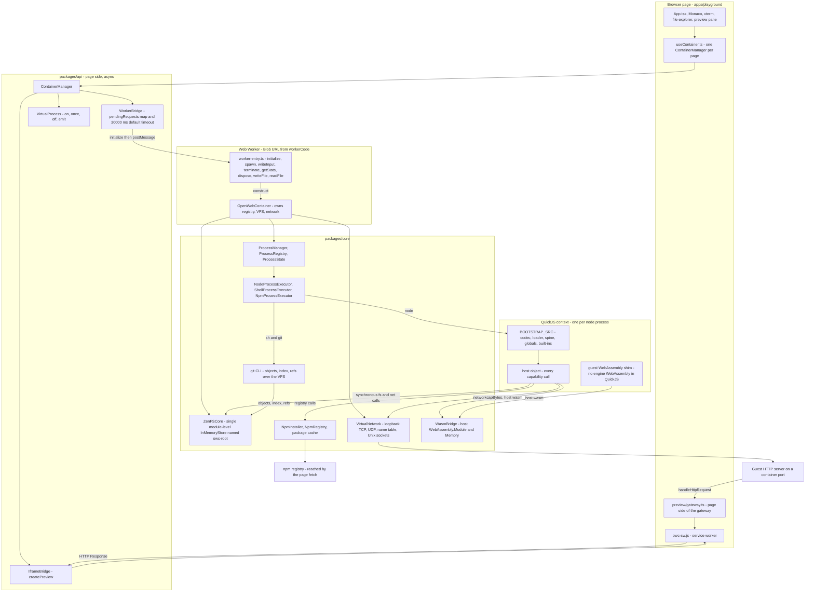
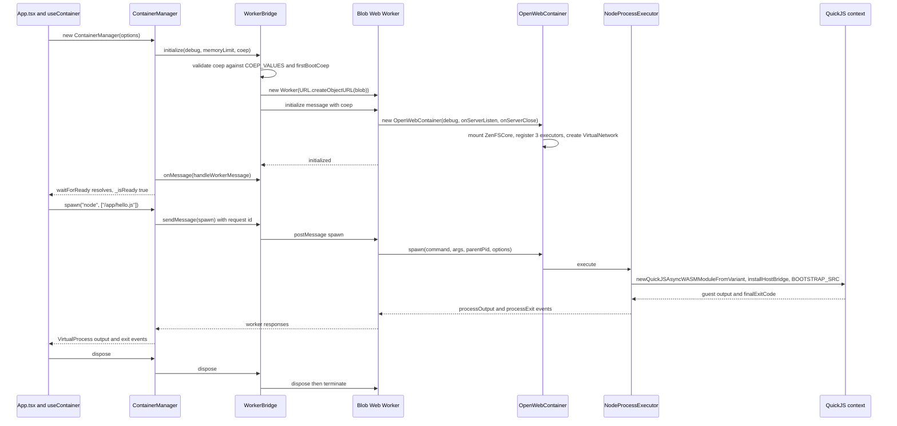
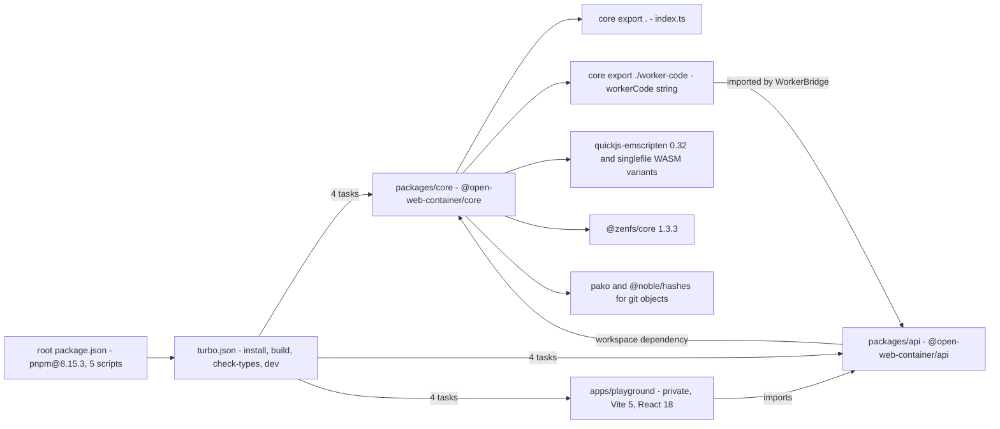
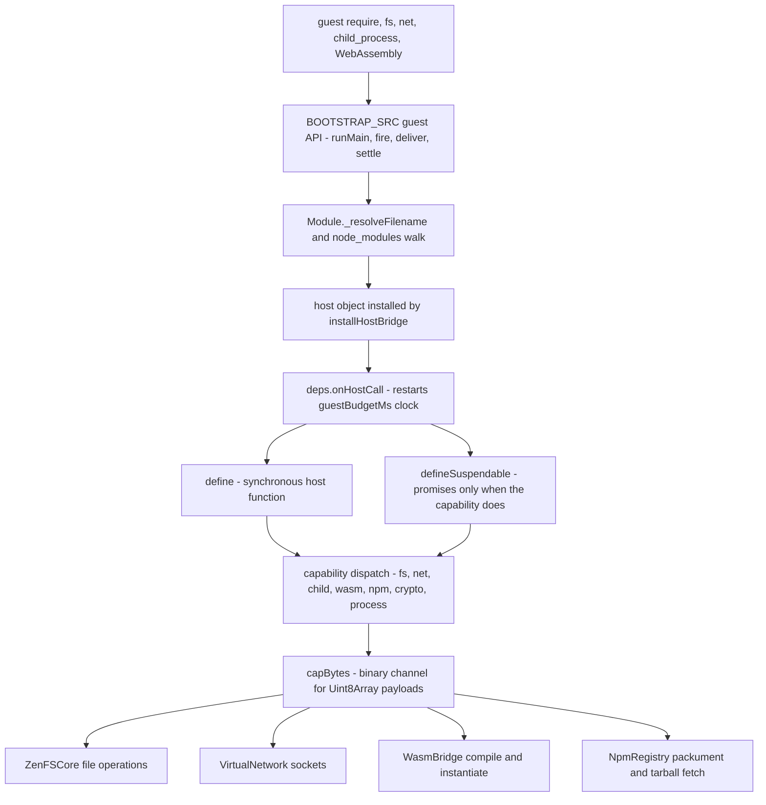
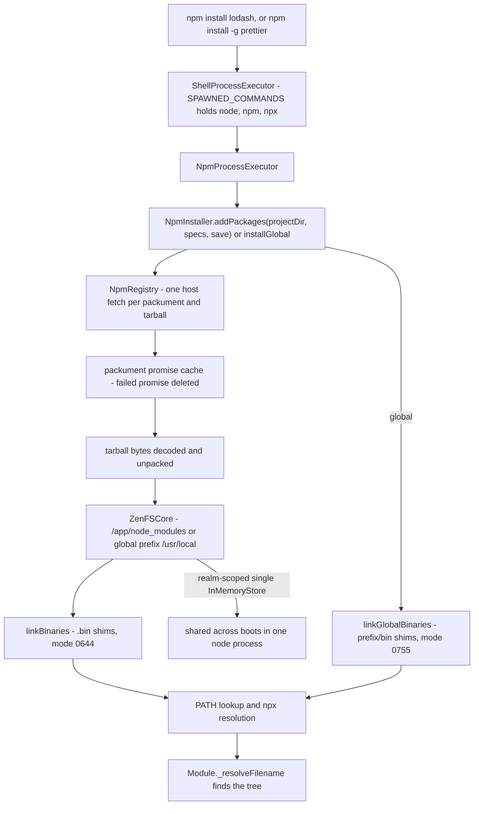
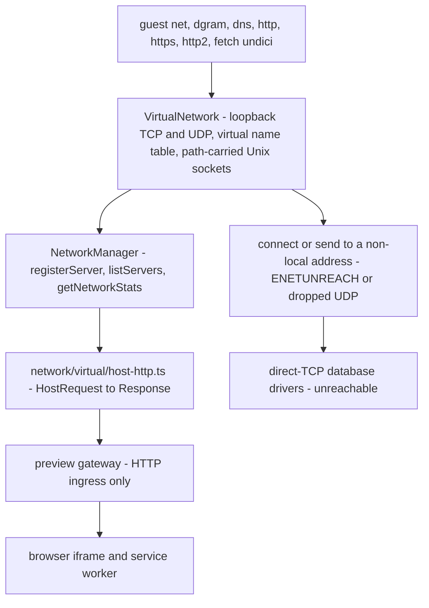
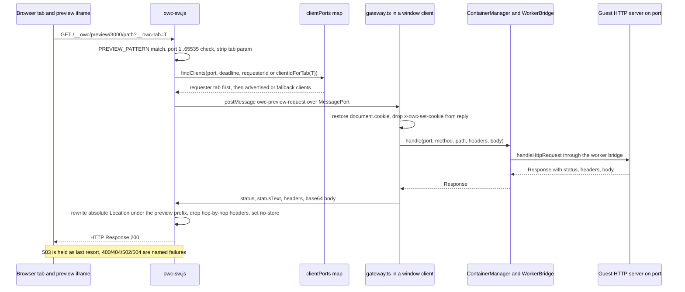
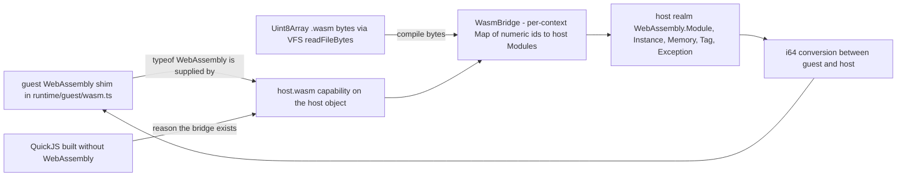
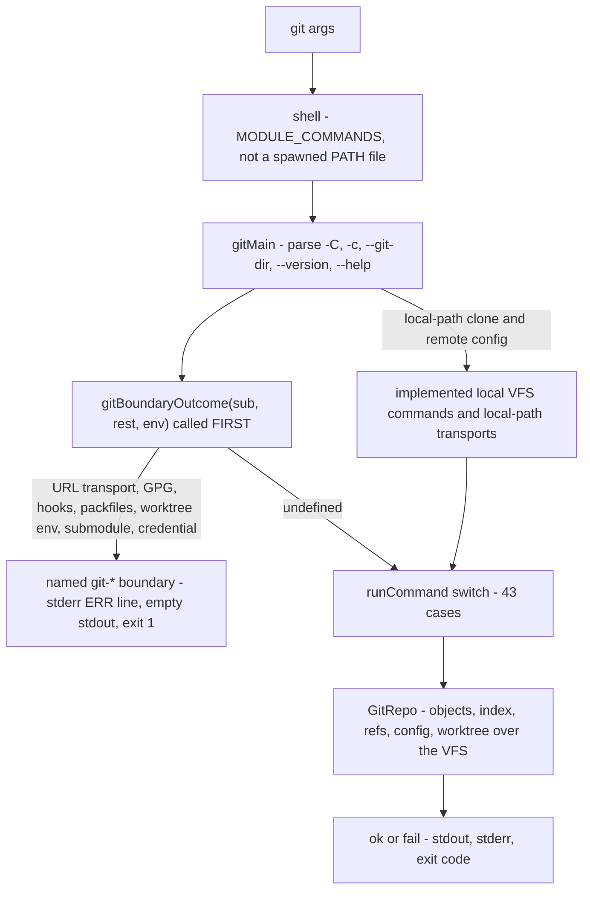

# Architecture

OpenWebContainer runs a Node-like environment entirely inside a browser page. There is no host Node process and no Docker daemon. The layers below are the real paths on `origin/main`.

## Browser page and Web Worker

- `apps/playground/` — the React + Vite playground: `src/App.tsx`, a Monaco editor, an xterm terminal, a file explorer, and a preview pane. `src/hooks/useContainer.ts` holds **one** `ContainerManager` for the page's lifetime.
- `packages/api/` — the browser-facing layer. `ContainerManager` (`src/container/container.ts`) owns a `WorkerBridge` (`src/worker/bridge.ts`), exposes `VirtualProcess` (`src/process/process.ts`), and previews through `IframeBridge` (`src/iframe/bridge.ts`).
- `WorkerBridge` imports `workerCode` from `@open-web-container/core/worker-code`, wraps it in a `Blob`, and starts `new Worker(URL.createObjectURL(blob))`. `packages/core/src/worker-entry.ts` holds the worker's `self.onmessage` switch and constructs `OpenWebContainer`.
- `WorkerInitOptions` carries `coep?: 'require-corp' | 'credentialless' | 'none'`; `WorkerBridge` fixes it at first boot, so it cannot be changed on a later reboot. `ContainerOptions` in `packages/api/src/container/types.ts` also carries `debug`, `maxProcesses`, `memoryLimit`, `coep`, `onServerListen` and `onServerClose` (defaults: `debug=false`, `maxProcesses=10`, `memoryLimit=512MB`, `coep='none'`).

## QuickJS and the guest runtime

- `packages/core/package.json` depends on `quickjs-emscripten` `^0.32.0` and the `@jitl/quickjs-singlefile-browser-release-*` variants. `packages/core/src/process/executors/node/process.ts` creates the runtime with `newQuickJSAsyncWASMModuleFromVariant`.
- QuickJS is built **without WebAssembly**, so guest WebAssembly is supplied by the host realm (`packages/core/src/process/executors/node/runtime/wasm-host.ts`, `WasmBridge` and `installWasmBridge`).
- `installHostBridge(context, deps)` in `packages/core/src/process/executors/node/runtime/host-bridge.ts` installs the host object inside the QuickJS context; it is called from `bootWith` in `node/process.ts`. Every capability call from guest code crosses this bridge.
- `BOOTSTRAP_SRC` in `packages/core/src/process/executors/node/runtime/bootstrap.ts` is one expression evaluated once per QuickJS context (`owc-bootstrap.js`). It receives the host bridge and returns the guest API (`runMain`, `fire`, `deliver`, `settle`, `keysOf`, `exportsOf`, `finalExitCode`, ...). It concatenates the guest sources: codec, loader, spine, path events, util/assert, buffer-fs, misc, globals, wasm and the built-in modules.
- `NODE_VERSION` in `runtime/guest/globals.ts` is `v24.15.0`, the host version the differential measurements target.

## Virtual file system

- `packages/core/src/filesystem/zenfs-core.ts` (`ZenFSCore`) imports `@zenfs/core` `^1.3.3`; `zenfs-listing.ts` and `virtual-fs.ts` complete the surface. `OpenWebContainer` constructs `new ZenFSCore()`.
- File operations are synchronous inside the worker. `writeFile(path, content: string | Uint8Array)` stores bytes for a `Uint8Array` and text for a string; `readFileBytes` reads bytes back. Writing binary decoded as UTF-8 is lossy, so use bytes for WASM and other binary files.
- A sparse-file write is recorded as parts rather than a buffer the size of the hole (`runtime/guest/buffer-fs.ts`), so a 5-byte write at a 1 GiB offset costs only the bytes written.

## Processes and shell

- `packages/core/src/process/` holds `Process`, `ProcessRegistry`, `ProcessManager`, the event emitter and `ProcessEvent` (`start`, `exit`, `error`, `message`, `spawn_child`).
- `packages/core/src/process/executors/` holds the three executors registered by `OpenWebContainer`: `node/executor.ts` (`NodeProcessExecutor`), `shell/executor.ts` (`ShellProcessExecutor`) and `npm/executor.ts` (`NpmProcessExecutor`). `packages/core/src/npm/installer.ts` (`NpmInstaller`) handles registry installs.
- `child_process` spawning, worker_threads and cluster are guest capabilities implemented over container processes.
- The runaway-guest guard is one QuickJS interrupt handler per runtime, carrying `guestBudgetMs` (default 30000; `0` disarms it). It interrupts an *uninterrupted stretch* of guest execution that made no host call; every host call, await or timer restarts the budget. There is no second host thread that can preempt a busy worker.

## Virtual network

- `packages/core/src/network/virtual/hub.ts` exports `VirtualNetwork`, a loopback TCP/UDP network between processes of one container with a virtual name table and path-carried Unix domain sockets. `network/virtual/host-http.ts` is the host HTTP bridge.
- `NetworkManager` (`packages/core/src/network/manager.ts`) registers servers and collects stats; `OpenWebContainer` exposes it as `readonly networkManager`.
- `net`, `dgram`, `dns`, `http`, `https` and `http2` are served over this network inside the guest. There is **no outbound raw TCP/UDP**; external requests go through the page's `fetch` when the browser host is involved. Guest `fetch` is the container's own `undici` module over its own `http`/`https` client, not the browser's or host Node's undici.

## Service-worker preview gateway

- `apps/playground/public/owc-sw.js` intercepts `/__owc/preview/<port>/<path>` (`PREVIEW_PATH_PREFIX = '/__owc/preview/'`) and posts each request to a window client.
- `apps/playground/src/preview/gateway.ts` (`PREVIEW_PREFIX = '/__owc/preview'`) starts `startPreviewGateway(handle)` and hands each service-worker request to the app's handler, which forwards it through the worker bridge to the guest HTTP server on that port; the response goes back over the `MessagePort` the service worker supplied. `IframeBridge` (`packages/api/src/iframe/bridge.ts`) is used by `ContainerManager.createPreview` for iframe previews.
- This is the only external ingress: **HTTP only**, no raw sockets. The diagram in `images/architecture.png` shows the page, bridge, worker and runtime layers.
- Two-tab live witness: 4 concurrent and 6 sequential `/__owc/preview/<port>/` requests per run, twice at each of two memory points (load 27.72 / 30.97, free 227 MB / 494 MB), all 40 answered 200 with their own tab/port body and request id — no cross-talk, no lost responses, no hang within a bounded deadline — and a reload between phases still answered; normalized fields are `latency` (→ `<t>`) and `port` (→ `<port>`).

## Diagrams

This page holds the maintained system-architecture visualizations. They are fenced Mermaid blocks: GitHub renders them as SVG and switches palette with the reader's light or dark setting. No block assigns a categorical colour palette, so nothing is encoded by colour alone; every block is followed by a **Text alternative** that carries the same information in prose. Labels are ASCII only. Path and line citations name `origin/main`; they were read from the source, not inferred. The older raster is kept at `images/architecture.png`. Lifecycle, budget, routing, retry and dispatch machines are on the [State machines](reference/state-machines.md) page.

| Diagram | Shape | Source anchor |
| --- | --- | --- |
| [Layered architecture](#1-layered-architecture) | flowchart | `packages/core/src/container.ts:55` |
| [Boot and first command](#2-boot-and-first-command) | sequenceDiagram | `packages/api/src/worker/bridge.ts:36-59`, `packages/core/src/worker-entry.ts:10-52` |
| [Workspace and package graph](#3-workspace-and-package-graph) | flowchart | `package.json`, `packages/core/package.json`, `packages/api/package.json`, `apps/playground/package.json`, `turbo.json` |
| [Capability bridge](#4-capability-bridge) | flowchart | `packages/core/src/process/executors/node/runtime/host-bridge.ts:99-125` |
| [VFS and npm install](#5-vfs-and-npm-install) | flowchart | `packages/core/src/filesystem/zenfs-core.ts:17-26`, `packages/core/src/npm/installer.ts:132,597,681,725` |
| [Virtual network](#6-virtual-network) | flowchart | `packages/core/src/network/virtual/hub.ts:3-8,34`, `packages/core/src/network/manager.ts` |
| [Multi-tab preview gateway](#7-multi-tab-preview-gateway) | sequenceDiagram | `apps/playground/public/owc-sw.js:12-30,83-148,162-227`, `apps/playground/src/preview/gateway.ts:113-227` |
| [WASM bridge](#8-wasm-bridge) | flowchart | `packages/core/src/process/executors/node/runtime/wasm-host.ts:4-13,86-87` |
| [Git command dispatch](#9-git-command-dispatch) | flowchart | `packages/core/src/git/cli.ts:13-51`, `packages/core/src/git/boundaries.ts:24-55` |

### 1. Layered architecture

**Text alternative.** Five layers, top to bottom: the playground page, the `packages/api` page-side layer, the Blob Web Worker, the `packages/core` runtime, and the QuickJS guest context. The page's `useContainer` hook creates one `ContainerManager`. `ContainerManager` owns `WorkerBridge`, `VirtualProcess` and `IframeBridge`. `WorkerBridge` creates the Blob Worker and exchanges numbered messages with `worker-entry.ts`, which constructs `OpenWebContainer`. That class owns `ProcessManager`, `ZenFSCore` and `VirtualNetwork`. The executors sit under `ProcessManager`. A `node` process evaluates `BOOTSTRAP_SRC` once per QuickJS context and every capability call crosses the `host` object installed by `installHostBridge`; `capBytes` is the binary channel. The shell dispatches `git` as a module command whose objects, index and refs are files in the same VFS. A guest HTTP server is reached from the page through `handleHttpRequest`, the preview gateway and the service worker. The npm registry is the only named network destination outside the browser. Sources: `packages/core/src/container.ts:1-18,55`, `packages/core/src/worker-entry.ts:10-52`, `packages/core/src/process/executors/node/runtime/bootstrap.ts:15-17`, `packages/core/src/process/executors/node/runtime/host-bridge.ts:99-125,321`, `packages/core/src/filesystem/zenfs-core.ts:17-26`.

### 2. Boot and first command

**Text alternative.** Construction immediately starts initialization. `WorkerBridge.initialize` validates `coep` against `COEP_VALUES` and `firstBootCoep`, creates the Blob Worker, sends `initialize`, and only then marks itself initialized. The worker's `initialize` case constructs `OpenWebContainer`, which mounts the VFS and registers the three executors, then replies `initialized`. Only after that does `ContainerManager` attach its message handler and resolve `waitForReady()`. A spawn is a numbered `sendMessage` request; the worker's `spawn` case calls `container.spawn`, attaches `setupProcessHandlers`, and replies with the pid. The node executor creates the QuickJS runtime, installs the host bridge and evaluates the bootstrap; output and exit events travel back up through the worker responses to `VirtualProcess`. Disposal sends `dispose` and then terminates the worker. Sources: `packages/api/src/container/container.ts:19-60`, `packages/api/src/worker/bridge.ts:19-59,61-92,101-119,130-140`, `packages/core/src/worker-entry.ts:10-52`, `docs/architecture.md` sections on QuickJS and processes.

### 3. Workspace and package graph

**Text alternative.** The root manifest pins `pnpm@8.15.3` and owns five scripts; `turbo.json` defines exactly four tasks. All three workspace packages are driven by those tasks. The playground imports `@open-web-container/api`, which depends on `@open-web-container/core` through `workspace:*`. Core exposes two entry points: `.` (the synchronous worker-side class) and `./worker-code` (the string the page wraps in a Blob). Core depends on `quickjs-emscripten`, `@zenfs/core`, `pako` and `@noble/hashes`. Sources: `Readme.md` project layout, `docs/development.md:3`, `docs/api.md:5-6`, `apps/playground/package.json`, `packages/core/package.json`, `turbo.json`, `packages/api/src/worker/bridge.ts:17,136-137`.

### 4. Capability bridge

**Text alternative.** Guest built-ins are implemented by `BOOTSTRAP_SRC`, one expression evaluated once per QuickJS context. Module resolution and capability calls reach the `host` object that `installHostBridge` installs. Every defined host function calls `deps.onHostCall()` first, which is what restarts the uninterrupted guest-execution budget. Plain `define` stays synchronous; `defineSuspendable` returns a promise only when the underlying capability does, so ordinary calls are not asyncified. `capBytes` carries binary payloads. Capability dispatch fans out to the VFS, virtual network, WASM bridge and npm registry. Sources: `packages/core/src/process/executors/node/runtime/host-bridge.ts:94-125,321`, `packages/core/src/process/executors/node/runtime/bootstrap.ts:15-17`, `packages/core/src/container.ts:32-37`.

### 5. VFS and npm install

**Text alternative.** `npm` is a spawned command, not a shell module command. `NpmInstaller` resolves specs through `NpmRegistry`, which performs one host fetch per packument or tarball and deletes a failed cached promise so a later process re-fetches. Tarballs are unpacked into the ZenFS tree. `linkBinaries` writes `#!/usr/bin/env node` shims into `node_modules/.bin` at mode 0644; a global install writes shims into `<prefix>/bin` at mode 0755 using the VFS `writeBytes` mode argument. `PATH` and `npx` then resolve those shims, and the guest loader resolves the installed tree. The VFS root is one module-level `InMemoryStore('owc-root')` guarded by `rootMounted`, so it is shared across container boots inside a single node process; a fresh node process per boot is the clean-isolation path. The installer has no internal retry: a transient `fetch failed` is handled by the corpus gate documented in `memory/owc-npm-fetch-transient-retry.md` and visualized in [State machines](reference/state-machines.md#6-npm-install-bounded-retry-corpus-gate). Sources: `packages/core/src/shell/shell.ts:85`, `packages/core/src/npm/installer.ts:132,597,681,725`, `packages/core/src/npm/config.ts:24,44`, `packages/core/src/npm/registry.ts`, `packages/core/src/filesystem/zenfs-core.ts:17-26`, `docs/reference/vfs-isolation.md`, `docs/reference/npm-global.md`.

### 6. Virtual network

**Text alternative.** All guest network modules terminate in `VirtualNetwork`, a loopback-only TCP and UDP network with a virtual name table and path-carried Unix domain sockets. `NetworkManager` registers servers and collects stats; `OpenWebContainer` exposes it as `readonly networkManager`. The only ingress from the browser is HTTP through `host-http.ts` and the service-worker preview gateway. A connect or send to a non-local address fails with `ENETUNREACH` or is dropped, which is why direct-TCP database drivers cannot work. Guest `fetch` is the container's own undici over its own `http`/`https` client, not the browser's or host Node's. Sources: `packages/core/src/network/virtual/hub.ts:3-8,34,73-82`, `packages/core/src/network/virtual/host-http.ts`, `packages/core/src/network/manager.ts`, `docs/architecture.md` virtual-network section, `docs/known-limitations.md`.

### 7. Multi-tab preview gateway

**Text alternative.** A navigation carries no client id, so the page puts its tab id in the `__owc-tab` URL parameter; the service worker maps that back to a window with `clientIdForTab`, and strips the parameter before the guest sees the path. `findClients` prefers the requesting tab, then windows that advertised the port, then all windows as a fallback. Each candidate is asked over a `MessagePort`; a 503 is kept as an answer of last resort rather than hiding the window that really serves the port. Full-deadline 25000 ms, fallback 4000 ms, no-client 10000 ms and poll 250 ms bound the wait. The page gateway restores `document.cookie`, applies `x-owc-set-cookie`, base64-encodes the body and replies; the service worker rewrites absolute redirects back under `/__owc/preview/<port>` with the tab id intact, drops hop-by-hop headers and sets `cache-control: no-store`. A two-tab live witness answered all 40 concurrent and sequential requests with their own tab and port bodies. Sources: `apps/playground/public/owc-sw.js:12-30,41-51,58-66,75-90,92-148,162-227,230-255`, `apps/playground/src/preview/gateway.ts:100-106,113-170,172-227`, `docs/architecture.md:44`.

### 8. WASM bridge

**Text alternative.** QuickJS is built without WebAssembly, so the guest `WebAssembly` object is a shim whose modules are compiled and instantiated in the host realm. `installWasmBridge` keeps a per-context map of numeric ids to host `WebAssembly.Module` objects and converts i64 values and `WebAssembly.Tag`/`Exception` across the boundary. Binary `.wasm` bytes must be written and read as `Uint8Array` through `writeFile`/`readFileBytes`: the text form is lossy and WebAssembly rejects it. Sources: `packages/core/src/process/executors/node/runtime/wasm-host.ts:4-13,36-49,85-87`, `packages/core/src/process/executors/node/runtime/guest/wasm.ts:64,585-586`, `docs/api.md:writeFile`, `docs/architecture.md` QuickJS section.

### 9. Git command dispatch

**Text alternative.** `git` is a shell module command: `MODULE_COMMANDS` holds it, `SPAWNED_COMMANDS` does not, and `HOST_UTILITY_PATHS` maps the name to `/usr/bin/git` only for path reporting. `gitMain` parses global options and returns the container-own `--version` line or help. It calls `gitBoundaryOutcome` before any subcommand: URL-based remote transports, GPG signing, hooks, packfiles, linked worktrees, submodules, credentials and environment overrides that repoint the repository leave the VFS are mapped to one of 18 named boundary keys, which produce the project `[CODE] not supported on this runtime` stderr line, empty stdout and exit 1 - never a bare 127. A local path is not a boundary, so a local-path clone falls through. Implemented commands reach `runCommand`'s 43-case switch and operate on `GitRepo` objects, index and refs stored as VFS files. Sources: `packages/core/src/git/cli.ts:7-51`, `packages/core/src/git/boundaries.ts:1-20,24-55`, `packages/core/src/shell/shell.ts:62,85`, `packages/core/src/filesystem/zenfs-core.ts:212-228`, `docs/reference/commands-git.md:23,41-51,82,122`.

## Where to go next

- [API reference](api.md) for the exact method and event signatures.
- [Compatibility](compatibility.md) and [Known limitations](known-limitations.md) for the measured boundaries.
- [Development](development.md) for the build order.
- [State machines](reference/state-machines.md) for container, process, COEP, budget, preview, retry and dispatch machines.
- [Diagram conventions](README.md#diagram-conventions) for rendering, accessibility and colour policy.
