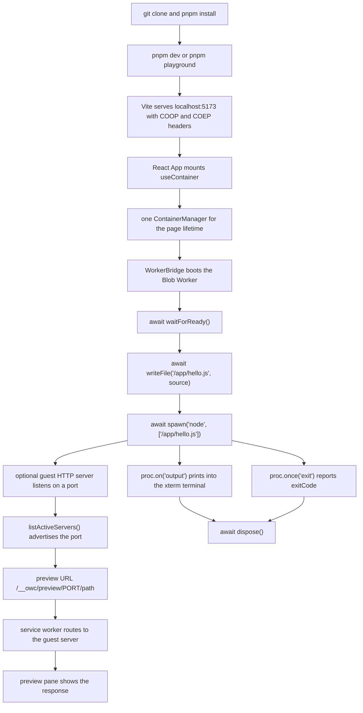

# Getting started

## Prerequisites

- **Git** and **Node.js**. The four real manifests (`package.json`, `packages/core/package.json`, `packages/api/package.json`, `apps/playground/package.json`) declare **no `engines` field** and there is no `.nvmrc` or `.node-version` on `origin/main`, so the repository states no minimum Node version. Compatibility work in this repo was measured against host Node **v24.15.0**.
- **pnpm**. The root `package.json` pins `"packageManager": "pnpm@8.15.3"`.
- A browser with Web Worker and service worker support. Cross-origin isolation is a host-page requirement; see [Known limitations](known-limitations.md).

## First-run flow diagram



**Text alternative.** After `pnpm install`, either `pnpm dev` (all packages through turbo) or `pnpm playground` (the playground filter) starts Vite on `localhost:5173`; `apps/playground/vite.config.ts` declares `Cross-Origin-Opener-Policy: same-origin` and `Cross-Origin-Embedder-Policy: require-corp` for both `server` and `preview`. The React app mounts `useContainer`, which creates one `ContainerManager` for the page's lifetime. That manager boots the Blob Worker and `waitForReady()` resolves. The first file is written with `await writeFile`, the first process is started with `spawn(command, args[])` where the arguments are an **array**, and output and exit events feed the xterm terminal. If the guest starts an HTTP server, `listActiveServers()` advertises its port, the preview URL is `/__owc/preview/<port>/<path>`, and the service worker forwards the request to that guest server. `dispose()` is the final page-side call. Sources: `docs/getting-started.md` install and first-container sections, `apps/playground/vite.config.ts:8-18`, `apps/playground/src/hooks/useContainer.ts`, `docs/api.md`, `apps/playground/public/owc-sw.js:83-90`.

The runtime path behind this flow is drawn in [Architecture diagrams](architecture.md#diagrams); the container and process states are in [State machines](reference/state-machines.md#1-container-lifecycle). Every diagram there has a plain-text alternative.

## Install

```bash
git clone https://github.com/dywongcloud/OpenWebContainer.git
cd OpenWebContainer
pnpm install
```

`pnpm install` is the workspace install: `pnpm-workspace.yaml` covers `packages/*` and `apps/*` (excluding `**/test/**` and `**/private/**`). The root `install` script is `turbo run install`.

## Start the playground

```bash
pnpm dev          # turbo run dev --parallel: all packages
# or
pnpm playground   # turbo run dev --filter='@open-web-container/playground'
```

Open <http://localhost:5173>. That is Vite's default port; `apps/playground/vite.config.ts` sets no `server.port`. The page is a React + Vite IDE with a file explorer, a Monaco editor, an xterm terminal and a preview pane. It boots one `ContainerManager` for the lifetime of the page (`apps/playground/src/hooks/useContainer.ts`) and polls `listActiveServers()` for preview ports.

`apps/playground/vite.config.ts` declares `Cross-Origin-Opener-Policy: same-origin` and `Cross-Origin-Embedder-Policy: require-corp` for both `server` and `preview`. Verify the headers your own deployment actually serves before depending on `SharedArrayBuffer`.

## First container

The playground creates the container for you. To create one directly, use the two real layers:

```ts
// Browser/page side (@open-web-container/api) — asynchronous, talks to the worker.
import { ContainerManager } from '@open-web-container/api';

const container = new ContainerManager();
await container.waitForReady();

await container.createDirectory('/app');
await container.writeFile('/app/hello.js', "console.log('Hello from the container');");

const proc = await container.spawn('node', ['/app/hello.js']);
proc.on('output', ({ output, isError }) => {
  (isError ? console.error : console.log)(output);
});
proc.on('exit', ({ exitCode }) => console.log('exit', exitCode));

await container.dispose();
```

Inside the worker, the same work is synchronous (`@open-web-container/core`):

```ts
import { OpenWebContainer } from '@open-web-container/core';

const core = new OpenWebContainer();
core.createDirectory('/app');
core.writeFile('/app/hello.js', "console.log('Hello from the container');");
const proc = await core.spawn('node', ['/app/hello.js']);
proc.addEventListener('message', (d) => console.log(d.stdout));
await core.dispose();
```

`spawn(command, args?)` takes the arguments as an **array**. See the [API reference](api.md) for every method and event, and for the method names that appear in the old chronological Readme but do not exist.

## First `node` and `sh` commands

In the playground terminal:

```sh
node -e "console.log(process.version)"
sh -c 'echo hello > /app/greeting.txt && cat /app/greeting.txt'
```

The core registers three process executors: `node`, `sh` and `npm`. `node -e <source>` works; the shell has built-ins (`ls`, `cd`, `pwd`, `mkdir`, `touch`, `rm`, `rmdir`, `cat`, `echo`, `cp`, `mv`), pipes and `>`/`>>` redirection. `npm install`, `npm run` and `npx` install and run real packages from the registry into the virtual file system.

## Preview ports

A guest HTTP server listens on a container port. The page-side gateway forwards browser requests to it through the service worker:

```
http://localhost:5173/__owc/preview/<port>/<path>
```

`apps/playground/public/owc-sw.js` matches `^/__owc/preview/(\d+)(/.*)?$` and posts the request to a window client; `apps/playground/src/preview/gateway.ts` (`PREVIEW_PREFIX = '/__owc/preview'`) completes the round trip. Only **HTTP ingress** is available — a browser cannot open raw TCP or UDP to the outside. See [Known limitations](known-limitations.md).

## Next

- [Architecture](architecture.md) for how the pieces fit and for the nine system diagrams.
- [State machines](reference/state-machines.md) for the container and process lifecycle tables.
- [API reference](api.md) before writing code against the packages.
- [Development](development.md) if you are changing the repository itself.
- [Troubleshooting](troubleshooting.md) if the terminal hangs or the tree looks stale.
