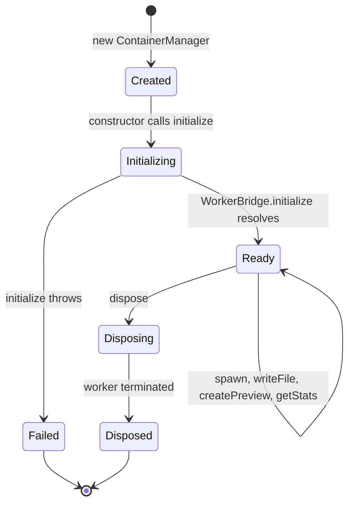
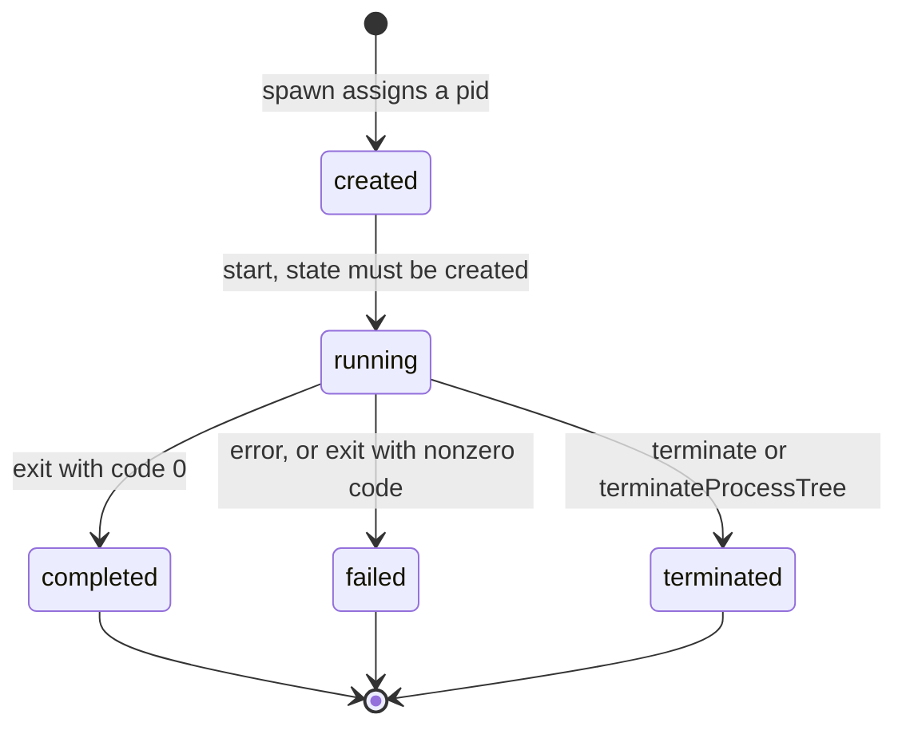
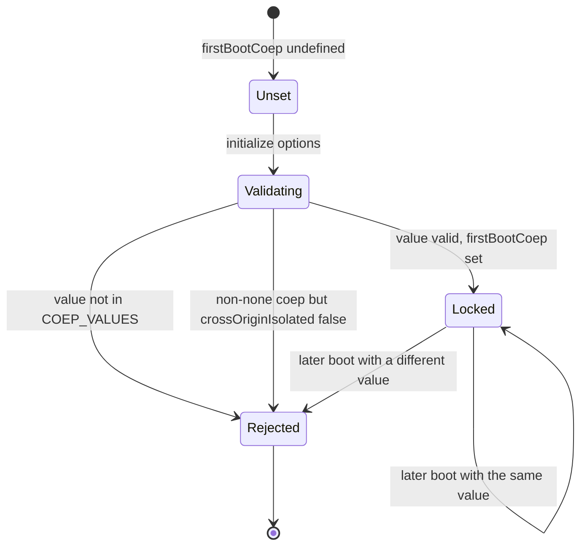
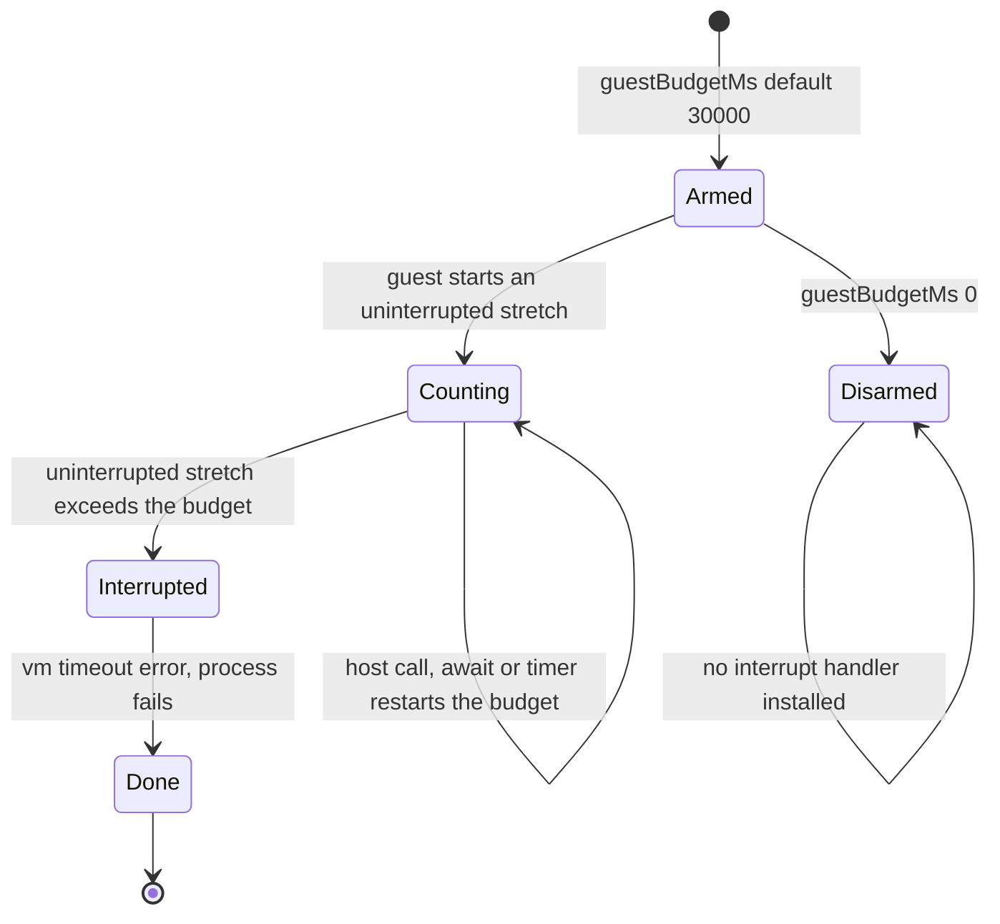
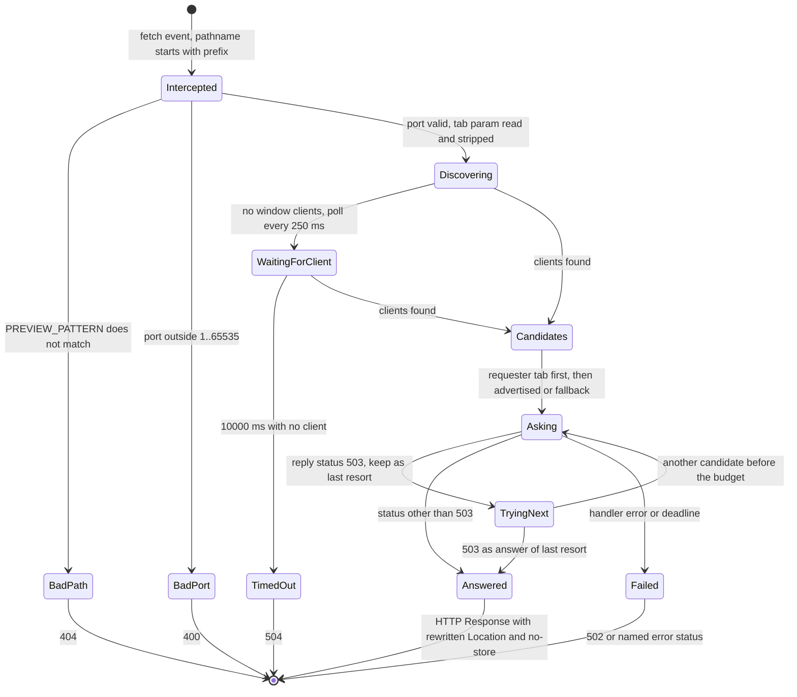
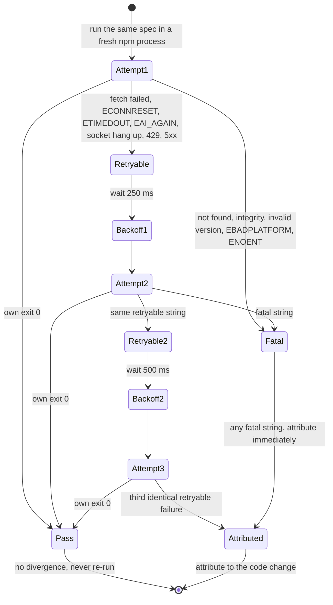
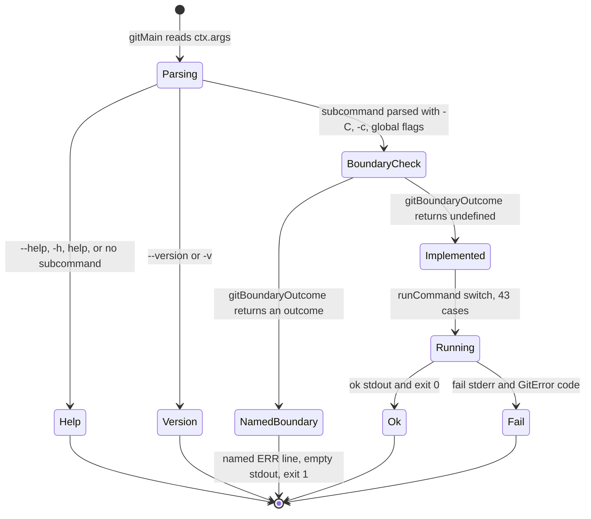
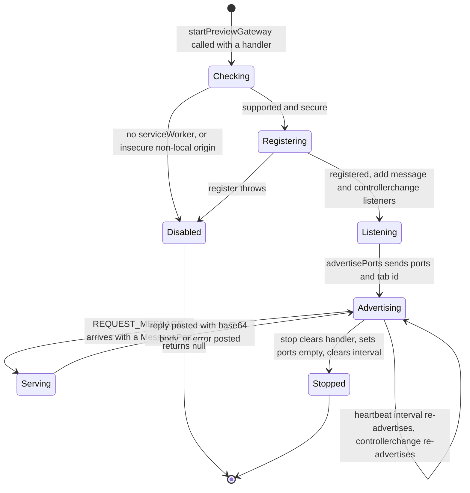
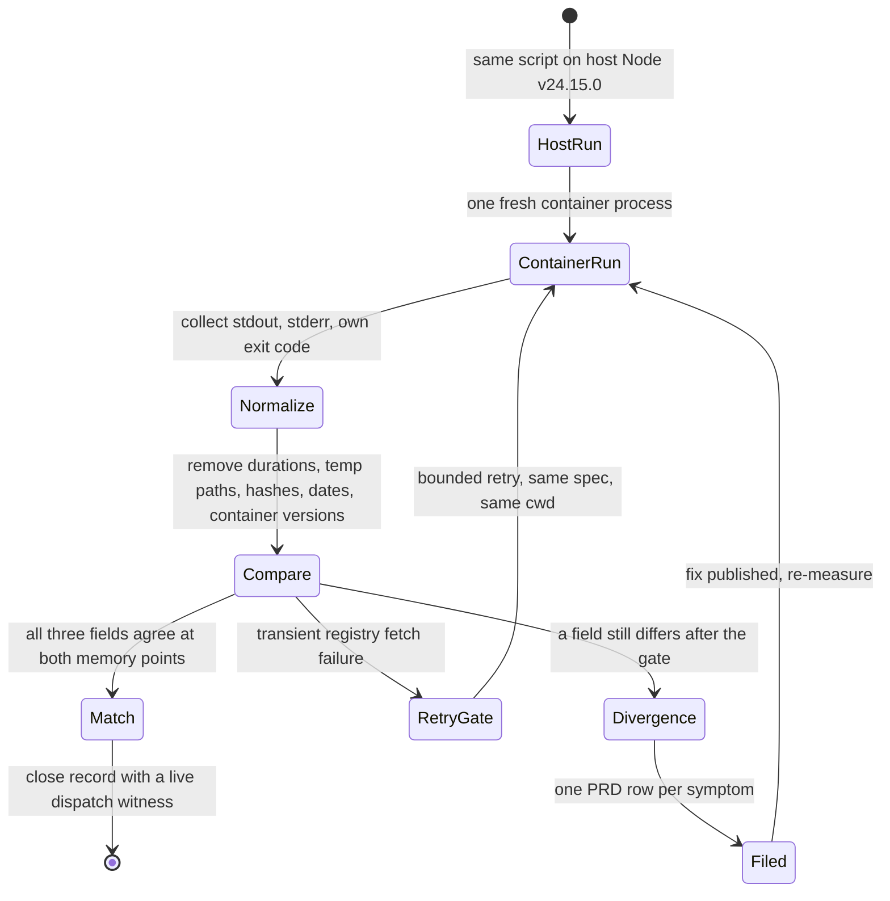
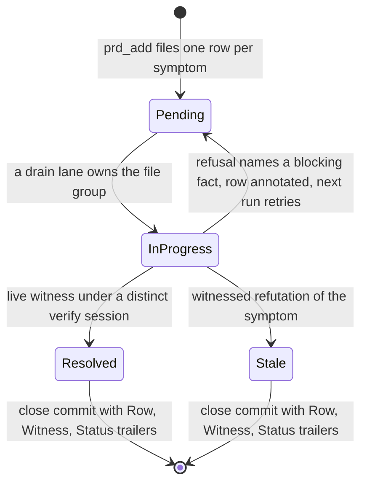

# State machines

This page documents the state machines of OpenWebContainer and of this repository's verification workflow. Every machine has a fenced Mermaid `stateDiagram-v2` block, a **Text alternative** in prose, and a transition table that carries the same states and events without the diagram. GitHub renders Mermaid as SVG in both light and dark colour modes; no block assigns a categorical palette, so no state is distinguishable by colour alone. Labels are ASCII only.

Two machines on this page are **not** product runtime behaviour and are labelled as such: [6. npm install bounded retry](#6-npm-install-bounded-retry-corpus-gate) is a corpus verification gate, and [9. differential verdict](#9-differential-compatibility-verdict) and [10. PRD row](#10-prd-row-lifecycle-workflow) are repository workflow machines. `NpmInstaller` itself performs one host fetch per packument or tarball with no internal retry; that fact is recorded in `memory/owc-npm-fetch-transient-retry.md`.

| Machine | Where | Source |
| --- | --- | --- |
| [1. Container lifecycle](#1-container-lifecycle) | product | `packages/api/src/container/container.ts:8-60` |
| [2. Process lifecycle](#2-process-lifecycle) | product | `packages/core/src/process/base/process.ts:67,180-214`, `base/types.ts:4-10` |
| [3. COEP first-boot lock](#3-coep-first-boot-lock) | product | `packages/api/src/worker/bridge.ts:19-50` |
| [4. Guest execution budget](#4-guest-execution-budget) | product | `packages/core/src/container.ts:28-38`, `runtime/host-bridge.ts:99-125` |
| [5. Preview request routing](#5-preview-request-routing) | product | `apps/playground/public/owc-sw.js:12-30,83-148,162-227` |
| [6. npm install bounded retry](#6-npm-install-bounded-retry-corpus-gate) | corpus gate | `memory/owc-npm-fetch-transient-retry.md:25-43` |
| [7. Git command dispatch](#7-git-command-dispatch) | product | `packages/core/src/git/cli.ts:13-51`, `boundaries.ts:38-55` |
| [8. Preview gateway registration](#8-preview-gateway-registration) | product | `apps/playground/src/preview/gateway.ts:113-170,172-227` |
| [9. Differential compatibility verdict](#9-differential-compatibility-verdict) | workflow | `Readme.md` How compatibility is decided, `docs/compatibility.md:19` |
| [10. PRD row lifecycle](#10-prd-row-lifecycle-workflow) | workflow | `.gm/prd/`, `closes/`, `docs/development.md` |

## 1. Container lifecycle



**Text alternative.** A container is created when `new ContainerManager(options)` runs, and the constructor immediately starts `initialize()`. A successful worker initialization sets `_isReady` and the container stays `Ready` through any number of spawn, file, preview and stats calls. A thrown initialization sets `_disposed = true` and rethrows; `waitForReady()` then rejects. `dispose()` terminates the worker and ends in `Disposed`. There is no transition back from `Failed` or `Disposed`.

| From | Event | To |
| --- | --- | --- |
| (start) | `new ContainerManager(options)` | Created |
| Created | constructor calls `initialize()` | Initializing |
| Initializing | `WorkerBridge.initialize` resolves, handler attached | Ready |
| Initializing | `initialize` throws, `_disposed` set true | Failed |
| Ready | spawn, writeFile, createPreview, getStats | Ready |
| Ready | `dispose()` | Disposing |
| Disposing | worker terminated | Disposed |
| Failed, Disposed | terminal | (end) |

Source: `packages/api/src/container/container.ts:8-60`, `packages/api/src/worker/bridge.ts:36-59,101-119`.

## 2. Process lifecycle



**Text alternative.** `ProcessState` has exactly five literal values: `created`, `running`, `completed`, `failed`, `terminated`. `start()` only advances from `created`; it throws for any other state. On a normal finish the state is `completed` when the exit code is 0 and `failed` otherwise, and an exception during execution also gives `failed`. `terminate()` requires `running` and yields `terminated`. All three outcomes are terminal. `ProcessEvent` carries `start`, `exit`, `error`, `message` and `spawn_child`; the page-side `VirtualProcess` instead exposes `output`, `exit` and `error` only.

| From | Event | To |
| --- | --- | --- |
| (start) | spawn assigns a pid | created |
| created | `start()`, guarded on `state === CREATED` (:180) | running |
| running | exit, `_exitCode === 0` (:192) | completed |
| running | exit, `_exitCode !== 0` (:192) | failed |
| running | exception in execution (:195) | failed |
| running | `terminate()` (:209-214) | terminated |
| completed, failed, terminated | terminal | (end) |

Source: `packages/core/src/process/base/types.ts:4-10,56-62`, `packages/core/src/process/base/process.ts:67,129,180-214`, `docs/api.md` process events tables.

## 3. COEP first-boot lock



**Text alternative.** `COEP_VALUES` is exactly `require-corp`, `credentialless`, `none`, defaulting to `none`. `firstBootCoep` is a module-level variable, so it is shared by every `WorkerBridge` in the page. The first `initialize()` validates the requested value against that array, then rejects a non-`none` value when the document is not cross-origin isolated, then stores the value. Any later boot with a different value throws `coep is fixed at first boot (...) and cannot change on a later boot (...)`. The check happens before `boot()`, so a failed validation never creates a Worker. Cross-origin isolation itself is the host page's job: `apps/playground/vite.config.ts` declares COOP `same-origin` and COEP `require-corp` for both `server` and `preview`.

| From | Event | To |
| --- | --- | --- |
| (start) | module load, `firstBootCoep` undefined | Unset |
| Unset | `initialize(options)` | Validating |
| Validating | value outside `COEP_VALUES` (:41-43) | Rejected |
| Validating | coep not `none` and `!self.crossOriginIsolated` (:48-50) | Rejected |
| Validating | valid value, `firstBootCoep = coep` (:47) | Locked |
| Locked | later boot, same value | Locked |
| Locked | later boot, different value (:44-46) | Rejected |
| Rejected | throw, no Worker created | (end) |

Source: `packages/api/src/worker/bridge.ts:19-50`, `apps/playground/vite.config.ts:8-18`, `docs/reference/isolation-boundaries.md`.

## 4. Guest execution budget



**Text alternative.** There is one QuickJS interrupt handler per runtime. It measures an **uninterrupted stretch** of guest execution that made no host call; every host call, await or timer restarts the clock. `installHostBridge` calls `deps.onHostCall()` at the top of every defined host function, which is the reset point. When the stretch exceeds `guestBudgetMs` the guest is stopped with the `vm` timeout error Node reports. `guestBudgetMs = 0` disarms the guard and leaves a runaway loop unstoppable, which hangs the browser tab. There is no second host thread that can preempt a busy worker: this interrupt fires from inside QuickJS.

| From | Event | To |
| --- | --- | --- |
| (start) | `guestBudgetMs` default 30000 (`container.ts:37`) | Armed |
| Armed | `guestBudgetMs = 0` | Disarmed |
| Armed | uninterrupted guest execution begins | Counting |
| Counting | host call, await or timer (`onHostCall`, `host-bridge.ts:103,120`) | Counting |
| Counting | uninterrupted stretch exceeds budget | Interrupted |
| Interrupted | `vm` timeout error, process state failed | Done |
| Disarmed | no interrupt handler | Disarmed |
| Done | terminal | (end) |

Source: `packages/core/src/container.ts:28-38`, `packages/core/src/process/executors/node/runtime/host-bridge.ts:99-125`, `docs/architecture.md` processes section, `docs/known-limitations.md`.

## 5. Preview request routing



**Text alternative.** The service worker intercepts only paths starting `/__owc/preview/`. A pattern miss is 404, an out-of-range port is 400. For a valid request it reads `__owc-tab` from the query, removes it from the path seen by the guest, and computes a 25000 ms deadline. With no window clients it polls every 250 ms up to 10000 ms and then reports 504. Once candidates exist, `findClients` puts the requesting tab first (whether or not it advertised the port), then windows that advertised the port, then all windows as a fallback. An advertised port gets the full deadline; a purely fallback path gets only 4000 ms. Each candidate is asked over a `MessagePort`; a 503 does not end the search because another window may serve the port, so it is held as the answer of last resort. A handler error or an expired deadline gives 502 or a named error status. A successful reply has absolute `Location` headers rewritten under the preview prefix with the tab id preserved, hop-by-hop headers dropped and `cache-control: no-store` set.

| From | Event | To |
| --- | --- | --- |
| (start) | `fetch`, prefix match (`owc-sw.js:83-90`) | Intercepted |
| Intercepted | `PREVIEW_PATTERN` miss (:93-96) | BadPath, 404 |
| Intercepted | port < 1 or > 65535 (:97-100) | BadPort, 400 |
| Intercepted | port valid, tab read (:101-103) | Discovering |
| Discovering | no clients (:163-171) | WaitingForClient |
| WaitingForClient | 10000 ms elapsed (:194-197) | TimedOut, 504 |
| WaitingForClient, Discovering | clients found | Candidates |
| Candidates | requester first, then advertised/fallback (:179-191) | Asking |
| Asking | 503 (:124-128) | TryingNext |
| TryingNext | candidate left before budget | Asking |
| TryingNext | no better answer, 503 kept (:134) | Answered |
| Asking | status != 503 (:127) | Answered |
| Asking | handler error or deadline (:135-147, 201-227) | Failed, 502 |
| Answered | rewrite, drop headers, no-store (:230-255) | (end) |

Source: `apps/playground/public/owc-sw.js:12-30,41-51,58-66,83-148,162-227,230-255`.

## 6. npm install bounded retry (corpus gate)

This machine is **not** the installer's control flow. `packages/core/src/npm/registry.ts` performs one host fetch per packument or tarball, has no internal retry, and deletes a failed cached promise so a fresh npm process re-fetches. This is the rule the differential corpus uses before it attributes a failure to a code change, measured at 144 installs with 0 natural failures and a controlled injection that cleared on one retry in 4/4 cases.



**Text alternative.** At most three attempts of the **same spec in the same cwd**, each in a fresh npm process, with backoff 250 ms then 500 ms (the rule names 1000 ms as the third step for a longer policy). A success on any attempt ends the case with no divergence and the case is never re-run for attribution. A fatal string ends the case immediately, without retry. Only three consecutive identical retryable failures justify attributing the failure to a code change. A failure that clears on retry is never a divergence.

| From | Event | To |
| --- | --- | --- |
| (start) | run spec in fresh npm process | Attempt1 |
| Attempt1 / Attempt2 / Attempt3 | own exit 0 | Pass |
| Attempt1 / Attempt2 | fatal string | Attributed |
| Attempt1 / Attempt2 | retryable string | Backoff1 / Backoff2 |
| Backoff1 | 250 ms | Attempt2 |
| Backoff2 | 500 ms | Attempt3 |
| Attempt3 | third identical retryable failure | Attributed |
| Pass, Attributed | terminal | (end) |

Retryable strings: `fetch failed`, `ECONNRESET`, `ETIMEDOUT`, `EAI_AGAIN`, `socket hang up`, HTTP 429, HTTP 5xx, `network`. Fatal strings: `not found in the registry`, `Integrity check failed`, `Invalid version or range`, `No matching version found`, `EBADPLATFORM`, `Global installs are not supported`, `ENOENT`. Source: `memory/owc-npm-fetch-transient-retry.md:25-43`, `packages/core/src/npm/registry.ts`, `closes/owc-container-npm-fetch-flake.txt`.

## 7. Git command dispatch



**Text alternative.** `gitMain` parses global options first, including `-C`, `-c` overrides stored as `GIT_OWC_CONFIG_OVERRIDES`, `--git-dir` and friends. `--version` returns the container-own `git version 2.53.0-owc.1` line, not the host's version string; `--help`, `help` and a missing subcommand return `GIT_HELP` (the missing-subcommand case with exit 1). For every other subcommand the boundary hook runs **first**. It returns a named outcome for URL transports, GPG signing, hooks, packfiles, linked worktrees, submodules, credentials and VFS-repointing environment variables: 18 `git-*` keys that all produce the project `[CODE] not supported on this runtime` stderr line, empty stdout and exit 1. A local path is not a boundary, so local-path clone, fetch, push, pull and ls-remote fall through. Implemented commands reach `runCommand`'s 43-case switch over `GitRepo`, whose objects, index and refs are VFS files. Any unrecognised subcommand is answered with the generic not-a-git-command line and never a bare 127.

| From | Event | To |
| --- | --- | --- |
| (start) | `gitMain(ctx)` | Parsing |
| Parsing | `--help`, `-h`, `help`, no subcommand (`cli.ts:23-24,42-43`) | Help |
| Parsing | `--version`, `-v` (:23) | Version |
| Parsing | subcommand with `-C`, `-c` (:25-41) | BoundaryCheck |
| BoundaryCheck | `gitBoundaryOutcome` defined (:44-45) | NamedBoundary |
| BoundaryCheck | `gitBoundaryOutcome` undefined | Implemented |
| Implemented | `runCommand(next, sub, rest)` (:48) | Running |
| Running | `ok` / `fail` | Ok / Fail |
| NamedBoundary | exit 1, empty stdout, named stderr | (end) |

Source: `packages/core/src/git/cli.ts:7-51`, `packages/core/src/git/boundaries.ts:24-55`, `packages/core/src/shell/commands/unsupported.ts:1837-1856`, `docs/reference/commands-git.md:23,41-51,82,122`.

## 8. Preview gateway registration



**Text alternative.** `startPreviewGateway(handle)` returns a stop function, or `null` when the browser cannot run the gateway. It refuses when `navigator.serviceWorker` is absent or the origin is neither a secure context nor a local host. Registration uses scope `/`; a throw disables the gateway. Once registered, the page advertises its live ports and tab id immediately, on a heartbeat interval (a worker the browser restarted has forgotten the map), and again on `controllerchange`. A changed port set triggers a new advertisement. Each `REQUEST_MESSAGE` is handled by the active handler; the reply carries status, headers and a base64 body, or an error. `stop()` clears the handler and interval and advertises an empty port set.

| From | Event | To |
| --- | --- | --- |
| (start) | `startPreviewGateway(handle)` (:113) | Checking |
| Checking | no serviceWorker or insecure origin (:133-140) | Disabled, returns null |
| Checking | supported | Registering |
| Registering | `navigator.serviceWorker.register` throws (:147-153) | Disabled |
| Registering | registered, listeners added (:142-159) | Listening |
| Listening | `advertisePorts()` (:155) | Advertising |
| Advertising | heartbeat (:164) or `controllerchange` (:157) | Advertising |
| Advertising | `REQUEST_MESSAGE` with `event.ports[0]` (:172-181) | Serving |
| Serving | `reply.postMessage` (:218-225) | Advertising |
| Advertising | `stop()` / `stopAll()` (:115-120,165-169) | Stopped |

Source: `apps/playground/src/preview/gateway.ts:113-170,172-227`, `apps/playground/public/owc-sw.js:41-51,75-81`.

## 9. Differential compatibility verdict

This is the repository's measurement workflow, not a runtime state machine. It is described in `Readme.md` under "How compatibility is decided" and in `docs/compatibility.md`.



**Text alternative.** Each case runs the same script on host Node v24.15.0 and in one fresh container process, collecting stdout, stderr and the process's own exit code. A witness compares at two memory points (free, and holding a 256 MB Buffer), twice per point. Normalization removes only durations, temporary paths (longest first), 40/7/8-hex commit hashes, author dates and container-own version strings, and names every normalized field. A transient registry failure goes through the bounded gate in machine 6 before anything is attributed. A surviving divergence is filed as one PRD row per symptom, fixed, and re-measured. A match is recorded with a live dispatch id in `closes/`. The repository has no `.github/workflows`, so these are reported measurements, not CI verification.

| From | Event | To |
| --- | --- | --- |
| (start) | run on host Node v24.15.0 | HostRun |
| HostRun | one fresh container process | ContainerRun |
| ContainerRun | collect stdout, stderr, own exit code | Normalize |
| Normalize | name and remove allowed fields | Compare |
| Compare | three fields agree at both memory points, twice each | Match |
| Compare | transient registry failure | RetryGate, then ContainerRun |
| Compare | field still differs | Divergence |
| Divergence | one row per symptom | Filed |
| Filed | fix published | ContainerRun |
| Match | close record with witness | (end) |

Source: `Readme.md` How compatibility is decided, `docs/compatibility.md:15,19,28`, `memory/owc-npm-fetch-transient-retry.md`, `closes/`.

## 10. PRD row lifecycle (workflow)

This is the gm workflow state machine. It is included because `closes/` and `.gm/prd/` are part of this repository's published artifacts, not because it runs in the browser.



**Text alternative.** A symptom becomes one open row in `.gm/prd/`. A drain lane owns the row's file group. A refusal never creates a `blocked` state: the row stays open with its single blocking fact annotated, and the next run retries on the route that fact allows. A row closes only with a live dispatch id from the current run's ledger, produced under a session distinct from the resolver's; the close is recorded in a commit whose body carries `Row:`, `Witness:` and `Status:` on their own lines, with the open row file deleted. `Status` is `resolved` or `stale`. Writing `status: closed` into the YAML file does not close a row. The walk ends only when zero rows are pending **and** a fresh expansion pass files nothing.

| From | Event | To |
| --- | --- | --- |
| (start) | `prd_add`, one row per symptom | Pending |
| Pending | drain lane owns the file group | InProgress |
| InProgress | refusal, blocking fact annotated | Pending |
| InProgress | live `verify-*` witness, fix published | Resolved |
| InProgress | witnessed refutation | Stale |
| Resolved, Stale | close commit with three trailers | (end) |

Source: `/Users/dylanwong/.claude/skills/gm/SKILL.md` (Standing preferences, Witness, Closed rows), `.gm/prd/`, `.gm/prd-log.jsonl`, `closes/`, `docs/development.md`.

## Conventions

- Fenced ` ```mermaid ` blocks only; no generated images, no external diagram service, no script tags.
- GitHub selects the Mermaid theme from the reader's colour mode. No `classDef`, `style`, `linkStyle` or custom palette is used, so there is no categorical colour series to validate and no state is conveyed by colour alone.
- Every block has a prose **Text alternative** and every state machine has a state/event/next-state table, so the information survives without SVG, in a terminal reader or in a forced-colours browser.
- All labels are ASCII. Arrows are Mermaid's `-->` form; the diff introduces no decorative non-ASCII glyph.
- Each diagram names the pinned source paths and lines it was read from. A citation is a source, not a promise that the named command is complete or host-faithful.
- The verbatim archive `docs/reference/compatibility-notes.md` is never edited; corrections live in the maintained pages and are marked SUPERSEDED where they refer to it.

## Next

- [Architecture](../architecture.md) for the prose description and the nine system diagrams.
- [API reference](../api.md) for the exact exported surfaces.
- [Commands: git](commands-git.md) for the git boundary table.
- [Documentation index](../README.md) for every page.
